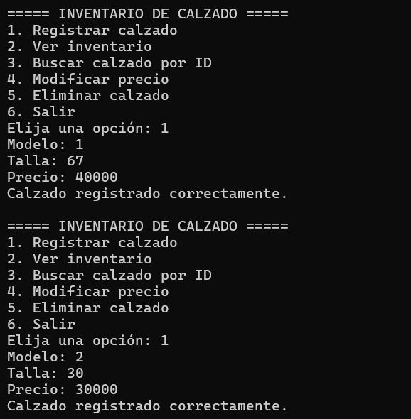
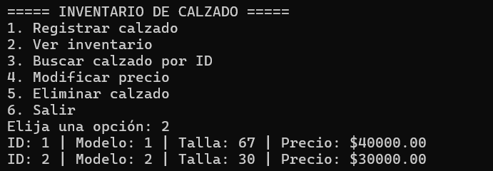
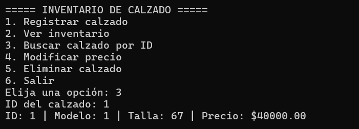
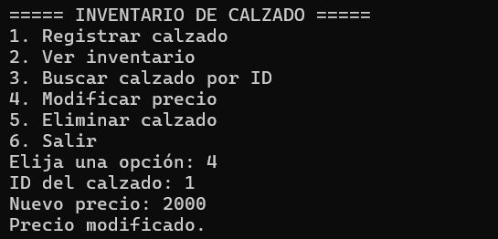
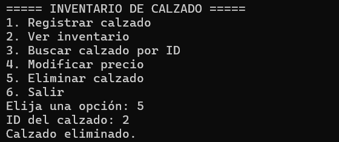
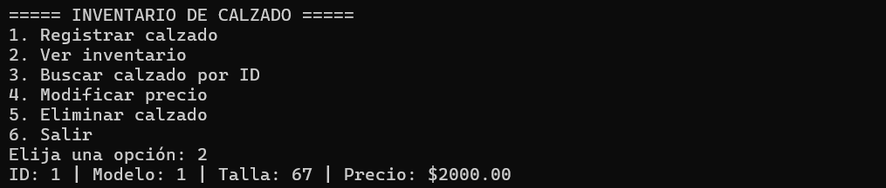

# Sistema de Inventario de Calzado — SQLAlchemy ORM

## 1. Información del proyecto

| Información | Descripción |
|---|---|
| Estudiante | Angel Angulo |
| Asignatura | Desarrollo de aplicaciones con bases de datos |
| Docente | Eduardo Pimienta |
| Fecha | 17 de noviembre de 2026 |
| Lenguaje de programación | Python |
| ORM utilizado | SQLAlchemy |
| Base de datos | SQLite |

## 2. Descripción del proyecto

**¿En qué consiste el programa?**

Es una aplicación de consola para administrar el inventario de una pequeña tienda de calzado. Guarda de cada calzado su identificador, modelo, talla y precio. Antes, el programa no conservaba nada; ahora la información se almacena de forma permanente en una base de datos SQLite (`inventario.db`) usando el ORM SQLAlchemy, de modo que los calzados siguen existiendo aunque se cierre el programa.

**¿Qué funcionalidades tiene?**

- Registrar calzados.
- Consultar el inventario.
- Buscar calzados por ID.
- Actualizar precios.
- Eliminar calzados.

## 3. Estructura del proyecto

```text
parcial-3-inventario-calzado/
├── main.py
├── datos.py
├── requirements.txt
├── README.md
├── .gitignore
└── evidencias/
    ├── registro.png
    ├── listado.png
    ├── busqueda.png
    ├── actualizacion.png
    ├── eliminacion.png
    └── persistencia.png
```

**Explicación de los archivos:**

| Archivo | ¿Cuál es su responsabilidad? |
|---|---|
| `main.py` | Contiene el menú de consola y la interacción con el usuario: pide los datos, valida que sean correctos y llama a las funciones de `datos.py`. Versión adaptada respecto al original. |
| `datos.py` | Capa de persistencia. Define el engine, la clase `Base`, el modelo `Calzado` y las funciones CRUD con SQLAlchemy. |
| `requirements.txt` | Lista la dependencia necesaria: `SQLAlchemy>=2.0,<3.0`. |
| `inventario.db` | Archivo de base de datos SQLite. Se genera automáticamente la primera vez que se ejecuta `main.py` (al llamar a `iniciar_bd()`), en la carpeta desde donde se ejecuta el programa. No se sube al repositorio. |

## 4. Instalación y ejecución

**Paso 1. Requisitos**

Tener instalado Python 3.8 o superior (se probó con Python 3.13) y `pip`. No hace falta instalar SQLite, porque viene incluido con Python.

**Paso 2. Clonar e instalar dependencias**

Clonar el repositorio, entrar a la carpeta e instalar las dependencias (opcionalmente dentro de un entorno virtual):

```bash
git clone <URL-DEL-REPOSITORIO>
cd parcial-3-inventario-calzado
python -m pip install -r requirements.txt
```

**Paso 3. Ejecución**

```bash
python main.py
```

**Paso 4. Resultado esperado**

Aparece el menú "INVENTARIO DE CALZADO" con las opciones del 1 al 6. Se crea el archivo `inventario.db` y se puede registrar, listar, buscar, actualizar y eliminar calzados.

---

# 5. Documentación técnica — Preguntas obligatorias

### Pregunta 1. Modelo y tabla

¿Qué clase de Python representa la tabla de la base de datos? Explica cómo SQLAlchemy identifica el nombre de la tabla y sus columnas.

**Respuesta:**

La tabla la representa la clase `Calzado`, que hereda de `Base`, una clase que a su vez hereda de `DeclarativeBase`. SQLAlchemy toma el nombre de la tabla del atributo `__tablename__`, que en este caso es `"calzados"`. Las columnas salen de los atributos de la clase anotados con `Mapped[...]`: cada uno se convierte en una columna, y el tipo de Python indica el tipo SQL (`int` → INTEGER, `float` → DOUBLE, `str` → VARCHAR). El atributo `id` se marca con `primary_key=True`, por lo que es la clave primaria y se genera automáticamente.

**Fragmento de código relacionado:**

```python
class Base(DeclarativeBase):
    pass


class Calzado(Base):
    __tablename__ = "calzados"

    id: Mapped[int] = mapped_column(primary_key=True, autoincrement=True)
    modelo: Mapped[str] = mapped_column(String)
    talla: Mapped[int]
    precio: Mapped[float]
```

Cada objeto `Calzado` que creo en Python corresponde a una fila de la tabla `calzados`, y sus atributos (`modelo`, `talla`, `precio`) corresponden a las columnas.

### Pregunta 2. Creación de la base de datos

¿Qué ocurre cuando ejecutas el programa por primera vez? Explica cómo se crea la base de datos `inventario.db` y la tabla `calzados`.

**Respuesta:**

Al ejecutar `python main.py`, la primera instrucción de `main()` es `datos.iniciar_bd()`. Esa función llama a `Base.metadata.create_all(motor)`, que revisa todos los modelos que heredan de `Base` y crea sus tablas si todavía no existen. Para hacerlo, SQLAlchemy abre una conexión a través del engine, configurado con `sqlite:///inventario.db`; como el archivo no existe, SQLite lo crea en ese momento y dentro de él se crea la tabla `calzados` con sus cuatro columnas. En las siguientes ejecuciones el archivo y la tabla ya existen, así que `create_all` no hace nada y no borra los datos.

**Fragmento de código relacionado:**

```python
motor = create_engine("sqlite:///inventario.db")

def iniciar_bd():
    Base.metadata.create_all(motor)
```

### Pregunta 3. Registro de calzados

Cuando seleccionas la opción de registrar un calzado, ¿qué recorrido siguen los datos desde el menú hasta quedar almacenados en SQLite? Identifica las funciones utilizadas.

**Respuesta:**

1. En `main()` el usuario elige la opción `1` y escribe modelo, talla y precio con `input()`. `main.py` convierte la talla a `int` y el precio a `float`, y valida que el modelo no esté vacío y que talla y precio sean positivos.
2. Si los datos son válidos, `main.py` llama a `datos.registrar_calzado(modelo, talla, precio)`.
3. Dentro de `registrar_calzado` se crea un objeto `Calzado` con esos valores.
4. Se abre una sesión con `Session(motor)`, se agrega el objeto con `sesion.add()` y se confirma con `sesion.commit()`. En el `commit` SQLAlchemy genera el `INSERT` y lo ejecuta en SQLite, que asigna el `id`.
5. La función devuelve `True` y `main.py` muestra "Calzado registrado correctamente.", como se ve en la captura `registro.png`.

**Fragmento de código relacionado:**

```python
def registrar_calzado(modelo, talla, precio):
    nuevo = Calzado(modelo=modelo, talla=talla, precio=precio)
    with Session(motor) as sesion:
        sesion.add(nuevo)
        sesion.commit()
    return True
```

### Pregunta 4. Sesiones y transacciones

¿Para qué se utiliza una sesión de SQLAlchemy? ¿Qué ocurriría si agregas o modificas un objeto, pero no confirmas la transacción con `commit()`?

**Respuesta:**

La sesión es el intermediario entre los objetos de Python y la base de datos. Mantiene un registro de los objetos que se agregan, modifican o eliminan, y agrupa esos cambios en una transacción que se envía a la base de datos cuando se llama a `commit()`. En mi programa cada función abre su sesión con `with Session(motor) as sesion:`, de modo que la sesión se cierra automáticamente al terminar.

Si agrego o modifico un objeto y no hago `commit()`, los cambios quedan solo pendientes dentro de la transacción. Al cerrarse la sesión, la transacción se revierte (rollback) y la base de datos queda como estaba: el calzado no se registraría, el precio no cambiaría o el registro no se eliminaría, aunque el programa no muestre ningún error.

### Pregunta 5. Búsqueda por ID

¿Cómo funciona la búsqueda de calzados por ID? Explica qué devuelve tu función cuando encuentra el registro y qué devuelve cuando no existe.

**Respuesta:**

`obtener_calzado(id_calzado)` abre una sesión y usa `sesion.get(Calzado, id_calzado)`, que consulta la tabla por su clave primaria. Si existe una fila con ese ID, devuelve un objeto `Calzado` con sus datos; si no existe, devuelve `None`. `main.py` revisa ese resultado: con `None` muestra "Calzado no encontrado.", y si hay objeto lo muestra con `imprimir_calzado`. En la captura `busqueda.png` se buscó el ID 1 y apareció el modelo 1, talla 67, precio $40000.00.

**Fragmento de código relacionado:**

```python
def obtener_calzado(id_calzado):
    with Session(motor) as sesion:
        return sesion.get(Calzado, id_calzado)
```

### Pregunta 6. Actualización de precios

¿Cómo se actualiza el precio de un calzado mediante el ORM? Explica cómo se obtiene el objeto, cómo se modifica su atributo y cómo se guarda el cambio.

**Respuesta:**

Primero se obtiene el objeto con `sesion.get(Calzado, id_calzado)`. Si es `None`, la función devuelve `False` porque no existe. Si existe, se modifica simplemente el atributo del objeto: `calzado.precio = nuevo_precio`. No se escribe ninguna sentencia SQL: la sesión detecta que el objeto cambió. Finalmente, `sesion.commit()` guarda el cambio, y en ese momento SQLAlchemy genera y ejecuta el `UPDATE`. En la prueba, el calzado con ID 1 pasó de 40000 a 2000 (`actualizacion.png`), y el nuevo precio se ve en `persistencia.png`.

**Fragmento de código relacionado:**

```python
def modificar_precio(id_calzado, nuevo_precio):
    with Session(motor) as sesion:
        calzado = sesion.get(Calzado, id_calzado)
        if calzado is None:
            return False
        calzado.precio = nuevo_precio
        sesion.commit()
        return True
```

### Pregunta 7. Eliminación de registros

¿Qué ocurre cuando eliminas un calzado? Explica cómo compruebas que el registro ya no existe en la base de datos.

**Respuesta:**

`borrar_calzado` obtiene el objeto con `sesion.get()`; si no existe devuelve `False`. Si existe, lo marca para borrado con `sesion.delete(calzado)` y `sesion.commit()` ejecuta el `DELETE` sobre la tabla, y devuelve `True`. Eliminé el calzado con ID 2 (modelo 2) y el programa mostró "Calzado eliminado." (`eliminacion.png`). Para comprobarlo, volví a listar los calzados: solo aparece el ID 1. Otra forma de comprobarlo es buscar el ID 2, que ahora devuelve `None` y muestra "Calzado no encontrado.".

**Fragmento de código relacionado:**

```python
def borrar_calzado(id_calzado):
    with Session(motor) as sesion:
        calzado = sesion.get(Calzado, id_calzado)
        if calzado is None:
            return False
        sesion.delete(calzado)
        sesion.commit()
        return True
```

### Pregunta 8. Persistencia de datos

¿Qué sucede con los calzados registrados cuando cierras y vuelves a ejecutar el programa? Explica por qué permanecen almacenados.

**Respuesta:**

Los calzados siguen ahí. Los datos no se guardan en variables del programa (que desaparecen al cerrarlo), sino en el archivo `inventario.db`, que está en el disco. Al volver a ejecutar, `iniciar_bd()` llama a `create_all`, que no borra ni recrea una tabla que ya existe, y `obtener_calzados()` lee las filas guardadas. Lo comprobé cerrando el programa con la opción 6, ejecutando de nuevo `python main.py` y listando: apareció el calzado con ID 1 (modelo 1, talla 67) con el precio ya actualizado a $2000.00, y el ID 2 no aparece porque fue eliminado (`persistencia.png`).

---

## 6. Pruebas de funcionamiento y evidencias

### Prueba 1. Registrar calzados

- **Acción realizada:** registrar dos calzados.
- **Datos utilizados:** modelo 1, talla 67, precio 40000; y modelo 2, talla 30, precio 30000.
- **Resultado obtenido:** en ambos casos el programa mostró "Calzado registrado correctamente.".

**Evidencia:**



### Prueba 2. Listar inventario

- **Acción realizada:** consultar todos los calzados.
- **Resultado obtenido:** el programa listó los dos calzados con ID 1 (modelo 1) e ID 2 (modelo 2), con su talla y precio.

**Evidencia:**



### Prueba 3. Buscar por ID

- **ID utilizado:** 1.
- **Resultado obtenido:** el programa mostró únicamente el calzado modelo 1, talla 67, precio $40000.00.

**Evidencia:**



### Prueba 4. Actualizar precio

- **Calzado seleccionado:** ID 1 (modelo 1).
- **Precio anterior:** 40000.
- **Precio nuevo:** 2000.
- **Resultado obtenido:** el programa mostró "Precio modificado.". El nuevo precio se ve en la captura de la Prueba 6.

**Evidencia:**



### Prueba 5. Eliminar calzado

- **ID eliminado:** 2 (modelo 2).
- **Resultado obtenido:** el programa mostró "Calzado eliminado.". La verificación se ve en la captura de la Prueba 6, donde solo queda el ID 1.

**Evidencia:**



### Prueba 6. Comprobar persistencia

- **Acción realizada:** cerrar y ejecutar nuevamente el programa.
- **Resultado obtenido:** al volver a ejecutar `python main.py` y listar, apareció solo el calzado con ID 1 (modelo 1, talla 67, precio $2000.00), con el precio ya actualizado. El ID 2 no aparece porque fue eliminado.

**Evidencia:**



### Pruebas con registros inexistentes

Se probaron las operaciones de buscar, actualizar y eliminar con un ID que no existe (por ejemplo, el 99).

| Operación | ¿Qué sucedió? |
|---|---|
| Buscar ID inexistente | `sesion.get()` devuelve `None` y el programa muestra "Calzado no encontrado.". No hay error ni se modifica la base. |
| Actualizar ID inexistente | `modificar_precio` no encuentra el objeto y devuelve `False`, sin hacer `commit`; el programa muestra "Calzado no encontrado.". |
| Eliminar ID inexistente | `borrar_calzado` no encuentra el objeto y devuelve `False`, sin hacer `commit`; el programa muestra "Calzado no encontrado.". |

## 7. Conclusiones

1. **¿Qué aprendí al implementar el CRUD con SQLAlchemy?** Aprendí que cada operación sigue la misma idea: abrir una sesión, obtener o crear un objeto, modificarlo y confirmar con `commit()`. También entendí la importancia del `commit()`, porque sin él los cambios no quedan guardados.
2. **¿Qué diferencia identifiqué entre objetos Python y SQL directo?** Con el ORM trabajo con objetos y atributos (`calzado.precio = 2000`) en lugar de escribir sentencias `INSERT`, `UPDATE` o `DELETE`. El código queda más corto y legible, y SQLAlchemy se encarga de generar el SQL.
3. **¿Cuál fue la principal dificultad y cómo la solucioné?** La mayor dificultad fue entender por qué los cambios no quedaban guardados al principio: olvidé llamar a `sesion.commit()` y, como el programa no mostraba ningún error, los datos simplemente no aparecían en la base. Lo resolví revisando cómo funciona la sesión y confirmando que cada operación que modifica datos (registrar, actualizar y eliminar) debe terminar con `commit()`.
